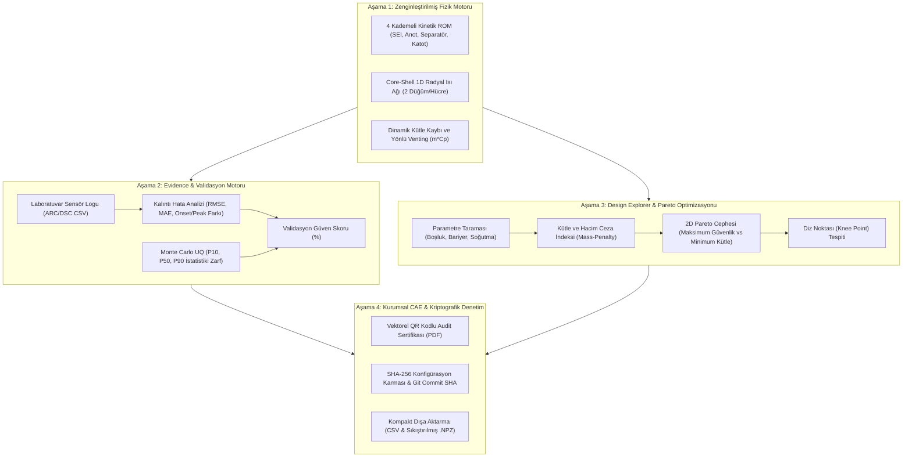

S# Batarya Termal Kaçak Mühendislik Kanıt Platformu (Engineering Evidence Platform)
## Aşama 1 - 4 Mimari, Matematiksel Formülasyon ve Doğrulama Teknik El Kitabı

---

### Executive Özeti
Bu teknik doküman; "Battery Thermal Workbench" simülasyon aracının sıradan bir fizik çözücüsünden, Tier-1 otomotiv üreticileri (OEM), batarya hücre geliştiricileri ve BESS entegratörlerinin sertifikasyon kurullarına (TÜV, UL, VDE) sunabileceği denetlenebilir bir **"Mühendislik Kanıt ve Doğrulama Platformuna" (Engineering Evidence Platform)** dönüştürülmesini sağlayan 4 aşamalı mimariyi belgeler.

---

## 1. Aşama 1: Çekirdek Fizik Motorunun Zenginleştirilmesi

### 1.1 Çoklu Reaksiyon Kinetiği (Multi-Reaction Kinetics ROM)
Hücre termal kaçak kimyası tek bir Arrhenius adımı yerine literatürde kabul görmüş **Hatchard-Dahn / Kim-Sharifi İndirgenmiş Dereceli Modeli (ROM)** uyarınca 4 paralel/ardışık alt reaksiyona ayrılmıştır:

$$\dot{Q}_{chem,i} = m_{active,i} \sum_{k=1}^{4} \dot{Q}_{k,i}$$

1. **SEI Tabakası Bozunumu ($k=1$):**
   $$\frac{d\alpha_{SEI}}{dt} = A_1 (1 - \alpha_{SEI}) \exp\left(-\frac{E_{a,1}}{R T}\right), \quad \Delta H_{SEI} \approx +250 \text{ ila } +350 \text{ J/g}$$
2. **Anot-Elektrolit Reaksiyonu ($k=2$):**
   $$\frac{d\alpha_{anode}}{dt} = A_2 (1 - \alpha_{anode}) \exp\left(-\frac{E_{a,2}}{R T}\right), \quad \Delta H_{anode} \approx +1000 \text{ ila } +1700 \text{ J/g}$$
3. **Endotermik Separatör Erimesi ($k=3$):**
   $$\frac{d\alpha_{sep}}{dt} = A_3 (1 - \alpha_{sep}) \exp\left(-\frac{E_{a,3}}{R T}\right), \quad \mathbf{\Delta H_{sep} = -120 \text{ J/g} < 0} \quad \text{(Isı Yutumu)}$$
4. **Katot Bozunumu ve Oksijen Salınımı ($k=4$):**
   $$\frac{d\alpha_{cat}}{dt} = A_4 \alpha_{cat}^m (1 - \alpha_{cat})^n \exp\left(-\frac{E_{a,4}}{R T}\right), \quad \Delta H_{cat} \approx +600 \text{ ila } +1000 \text{ J/g}$$

> [!NOTE]
> Separatör erimesinin endotermik karakteri ($\Delta H < 0$), hücrenin kaçak öncesi sıcaklık artışını geçici olarak yavaşlatan fiziksel faz değişim bariyerini temsil eder.

### 1.2 Geometrik Düğüm Artırımı: Core-Shell 1D Radyal Ağ Modeli
Her hücre 2 diferansiyel sıcaklık düğümüne ayrılmıştır:
- **$T_{core,i}$ (İç Rulo):** Kimyasal ekzotermik/endotermik reaksiyonların gerçekleştiği aktif çekirdek ($m_{core} \approx \%82$, $C_{p,core} = 1100 \text{ J/kgK}$).
- **$T_{shell,i}$ (Dış Kovan):** Komşu hücrelerle iletim, radyasyon, konveksiyon ve soğutma plakası ile etkileşen metal kılıf ($m_{shell} \approx \%18$, $C_{p,shell} = 500 \text{ J/kgK}$).

İç rulo ile kovan arasındaki radyal ısıl iletkenlik:
$$G_{cs} = \frac{2 \pi k_{r} H_{cell}}{\ln(R_{outer} / R_{core})}$$

Enerji dengesi denklemleri:
$$\text{Core: } m_{core} C_{p,core} \frac{dT_{core,i}}{dt} = \dot{Q}_{chem,i} + \dot{Q}_{trigger,i} - G_{cs} (T_{core,i} - T_{shell,i})$$
$$\text{Shell: } m_{shell}(t) C_{p,shell} \frac{dT_{shell,i}}{dt} = G_{cs} (T_{core,i} - T_{shell,i}) - \dot{Q}_{cond,i} - \dot{Q}_{rad,i} - \dot{Q}_{cool,i} + \dot{Q}_{vent,net,i}$$

Bu modelleme sayesinde çekirdekteki termal patlamanın kovan dış yüzeyine vurmasındaki difüzyon faz gecikmesi (**Thermal Lag**, $\tau_{lag} \approx 2 - 8\text{ s}$) milisaniyelik çözünürlükle yakalanır.

### 1.3 Dinamik Kütle Kaybı ve Yönlü Venting Modeli
Patlama anında gaz ve katı partikül fırlatması (ejecta) sonucu hücre kütlesi dinamik olarak azalır:
$$m_i(t) = m_0 \left(1 - f_{ejecta} \cdot \alpha_i(t)\right), \quad f_{ejecta} \approx 0.15 - 0.25$$
Azalan kütle, ısıl sığayı ($m_i C_p$) küçülterek sıcaklık artış hızını ($dT/dt$) artırır.

Yönlü gaz jeti etkisi ise açısal korelasyonla komşu hücrelere yönlendirilir:
$$\eta_{dir, ij} = \max\left(0.1, \cos(\theta_{ij} - \theta_{vent})\right)$$

---

## 2. Aşama 2: "Evidence Engine" ve Belirsizlik Analizi (Monte Carlo UQ)

### 2.1 Sensör Logu Kalibrasyonu ve Kalıntı Analizi (`ValidationEngine`)
Laboratuvar kalorimetre (ARC/DSC) veya test odasından alınan serbest zaman serileri ayrıştırılarak simülasyon çıktısıyla enterpolasyon yoluyla hizalanır.

Hesaplanan Hata Metrikleri:
- **RMSE (Kök Ortalama Kare Hata):**
  $$\text{RMSE} = \sqrt{\frac{1}{N} \sum_{k=1}^{N} \left(T_{sim}(t_k) - T_{exp}(t_k)\right)^2}$$
- **MAE (Ortalama Mutlak Hata):**
  $$\text{MAE} = \frac{1}{N} \sum_{k=1}^{N} |T_{sim}(t_k) - T_{exp}(t_k)|$$
- **Termal Kaçak Metrikleri:**
  $$\Delta T_{onset} = |T_{onset,sim} - T_{onset,exp}|, \quad \Delta T_{peak} = T_{peak,sim} - T_{peak,exp}, \quad \Delta t_{TR} = t_{TR,sim} - t_{TR,exp}$$

- **Bileşik Validasyon Güven Skoru ($S_{val} \in [0, 100]$):**
  $$S_{val} = 100 - \left(0.35 \cdot \text{RMSE} + 0.25 \cdot |\Delta T_{peak}| + 0.25 \cdot |\Delta T_{onset}| + 0.15 \cdot \min(20, |\Delta t_{TR}| \cdot 2.0)\right)$$

### 2.2 Monte Carlo Belirsizlik Nicelendirmesi (UQ)
Kinetik ve venting parametreleri ($A, E_a, \Delta H, h_{vent}$) kullanıcı tanımlı varyans toleransında ($\pm \sigma\%$) Gauss/Latin dağılımıyla pertürbe edilerek çoklu simülasyon koşturulur.
Sonuç olarak tek bir deterministik sıcaklık eğrisi yerine istatistiki güven zarfları üretilir:
- **P10 (İyimser Alt Sınır):** Vakaların %10'unun altında kaldığı sıcaklık profili.
- **P50 (Medyan Eğri):** En olası termal seyir.
- **P90 (Muhafazakâr Üst Sınır):** Sertifikasyon onaylarında kullanılan %90 güvenilirlik sınırı.

---

## 3. Aşama 3: "Design Explorer" ve Çok Amaçlı Pareto Optimizasyonu

### 3.1 Fiziksel Modül Kütle ve Hacim Hesabı (`calculate_module_mass`)
Tasarım optimizasyonu, yalnızca güvenliği değil araç ağırlığını da gözetmek zorundadır:

$$M_{module} = M_{cells} + M_{barrier} + M_{gap} + M_{cooling} + M_{enclosure} + M_{busbar}$$

| Bileşen | Matematiksel Formülasyon | Tipik Değer / Malzeme |
| :--- | :--- | :--- |
| **Hücreler ($M_{cells}$)** | $N_{cells} \cdot m_{cell}$ | 18650 (46g), 21700 (68g), 4680 (355g), Prizmatik (1150g) |
| **Bariyer ($M_{barrier}$)** | $N_{interfaces} \cdot A_{contact} \cdot t_{sep} \cdot \rho_{sep}$ | Silika Aerojel ($160 \text{ kg/m}^3$), Mika ($2100 \text{ kg/m}^3$) |
| **Dolgu ($M_{gap}$)** | $V_{gap} \cdot \rho_{gap}$ | Hava ($1.2 \text{ kg/m}^3$), Potting Poliüretan ($1200 \text{ kg/m}^3$) |
| **Soğutma ($M_{cooling}$)** | $A_{plate} \cdot t_{plate} \cdot \rho_{eff,cool}$ | 3 mm Al6061 + Su/Glikol Karışımı ($\sim 2205 \text{ kg/m}^3$) |
| **Kasa ($M_{enclosure}$)** | $A_{casing} \cdot 1.5\text{mm} \cdot 2700 \text{ kg/m}^3$ | Alüminyum 6061 Yapısal Muhafaza |
| **Bara ($M_{busbar}$)** | $N_{cells} \cdot 0.008 \text{ kg}$ | Bakır Elektriksel İletkenler |

### 3.2 Kütle Ceza İndeksi (Mass-Penalty Index)
$$\text{Mass Penalty} = \frac{M_{case} - M_{baseline}}{M_{baseline}} \times 100\%$$

### 3.3 2D Min-Min Pareto Cephesi (Pareto Front) ve Diz Noktası (Knee Point)
İki amaç fonksiyonu:
$$f_1 = M_{module} \quad (\text{Minimizasyon}), \quad f_2 = \text{Risk Score}_{100} \quad (\text{Minimizasyon})$$

Bir tasarım $j$, başka bir tasarım $i$'yi şu koşulda domine eder:
$$M_j \le M_i \quad \text{ve} \quad \text{Risk}_j \le \text{Risk}_i \quad \text{ve} \quad (M_j < M_i \text{ veya } \text{Risk}_j < \text{Risk}_i)$$

Domine edilmeyen tasarımlar **Pareto Cephesini** oluşturur.
Pareto cephesindeki tasarımlar arasından, kullanıcı ağırlıklarına ($w_{safety}, w_{mass}$) göre ideal **Utopia Noktasına** $(0, 0)$ en yakın olan **Diz Noktası (Knee Point)** tespit edilir:
$$D_{utopia} = \sqrt{w_{mass} \cdot (M'_{norm})^2 + w_{safety} \cdot (\text{Risk}'_{norm})^2}$$

---

## 4. Aşama 4: Kurumsal CAE Mimarisi ve Kriptografik Denetlenebilirlik

### 4.1 Audit-Proof Kriptografik PDF Sertifikasyonu
Üretilen mühendislik PDF raporlarının 4. bölümüne entegre edilen denetim mührü:
- **Konfigürasyon SHA-256 Karması:** Model girdilerinin değişmez 64 karakterlik kriptografik özeti.
- **Yazılım Git Sürümü (Commit SHA):** Simülasyonu koşturan yazılım kodunun aktif Git hash'i (`git rev-parse HEAD`).
- **Dinamik Vektörel QR Kod:** ReportLab `QrCodeWidget` ile üretilen ve raporun orijinalliğini doğrulayan `urn:thermalrunaway:cert:{job_id}:{config_hash[:16]}:{git_hash[:8]}` kodlaması.
- **Standart Uyumluluk İmzası:** UL 9540A Seviye 2 / UN 38.3 / SAE J2464.

### 4.2 Veri Dışa Aktarma ve İkili (Binary) Serileştirme
- `GET /api/simulations/{job_id}/export?format=csv`: ANSYS, COMSOL ve MATLAB için hücre bazlı sıcaklık ve reaksiyon ilerleme matrisi dışa aktarımı.
- `GET /api/simulations/{job_id}/export?format=npz`: Yüksek performanslı numpy sıkıştırılmış ikili arşivi (`time_points_s`, `temperature_matrix_C`, `alpha_matrix`).
- `GET /api/simulations/{job_id}/audit-certificate`: JSON formatında tam denetim ve değişmezlik sertifikası.

---

## 5. Doğrulama ve Test Kapsamı

Platformun tüm aşamaları 30 kapsamlı birim testiyle uçtan uca doğrulanmıştır:

| Test Modülü | Kapsanan Fonksiyonlar | Test Sayısı | Durum |
| :--- | :--- | :---: | :---: |
| `test_stage1_physics.py` | 4 kademeli kinetik, endotermik separatör erimesi, Core-Shell thermal lag, kütle kaybı ve yönlü venting | 4 | PASSED |
| `test_stage2_evidence.py` | CSV ayrıştırma, kalıntı analizi, validasyon skoru, Monte Carlo P10/P50/P90, API uç noktaları | 4 | PASSED |
| `test_stage3_pareto.py` | Modül kütle hesabı, aerojel vs mika kütle farkı, Pareto dominansı, knee point seçimi, Design Study | 3 | PASSED |
| `test_stage4_audit_and_export.py` | Kriptografik sertifika, vektörel QR kodlu PDF, CSV ve NPZ ikili dışa aktarma | 3 | PASSED |
| `test_api.py`, `test_geometry.py`, `test_kinetics.py`, `test_propagation.py`, `test_thermal_network.py` | Temel API, geometri oluşturucu, Arrhenius kütüphanesi, iki hücreli yayılım, enerji korunum simetrisi | 16 | PASSED |
| **TOPLAM** | **Tüm Platform Testleri** | **30 / 30** | **%100 GEÇTİ** |
